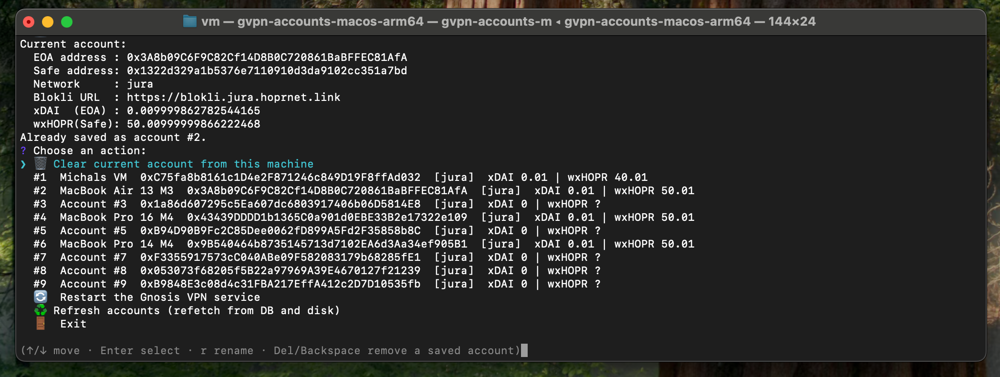

# Gnosis VPN Account Manager



A standalone Node.js CLI for managing multiple Gnosis VPN **accounts** (HOPR identities) on a single
machine and swapping the active one on demand. Encrypted account files are stored in MySQL so they
can be restored later.

This tool does not touch the Gnosis VPN client's binaries or packaging. It interacts with the
*installed* client through these external interfaces only:

1. **On-disk account files** — see [Where the account lives](#where-the-account-lives):
   - `hopr.id` — encrypted HOPR identity
   - `hopr.pass` — identity password
   - `hopr.safe` — YAML with `safe_address` + `module_address`
2. **The `gnosis_vpn-ctl` CLI** — `gnosis_vpn-ctl --output json balance` for the node EOA + safe.
3. **The service manager** — systemd (Linux) / launchd (macOS) to stop/start the client.
4. **Client-generated state**, when you reset a machine: the rest of the account's network slot
   (e.g. ticket and PIX databases), the runtime socket/lock files and the client and worker logs.
5. **The client's network configuration**, and only when you switch networks: the
   `/etc/gnosisvpn/config.toml` symlink, `/etc/gnosisvpn/gnosisvpn-dynamic.env` (Linux), and the
   launchd plist + `network_choice` (macOS). These are written exactly as the client's own
   installer writes them — see [Switching networks](#switching-networks).

### Where the account lives

Since installer **0.97.0** (client 0.98.0) the client runs its worker as the desktop user, and keeps
one account per user **and per network**:

| | Linux | macOS |
|---|---|---|
| `hopr.id`, `hopr.pass` | `~/.local/share/gnosisvpn/networks/<network>/` | `~/Library/Application Support/GnosisVPN/networks/<network>/` |
| `hopr.safe` (a cache) | `~/.cache/gnosisvpn/networks/<network>/` | `~/Library/Caches/GnosisVPN/networks/<network>/` |
| worker logs | `~/.local/state/gnosisvpn/` | `~/Library/Logs/GnosisVPN/` |

The user is the one you ran `sudo` from, else the desktop session's user; `--user <name>` picks
another. The network is the one the client is configured for (see [Networks](#networks)). Files
are written owned by that user, `0600`, in `0700` directories — as the worker creates them.

Older installers keep a single shared identity in `$GNOSISVPN_HOME/.config/gnosisvpn-hopr.{id,pass,safe}`
(Linux `/var/lib/gnosisvpn`, macOS `/Library/Application Support/GnosisVPN`), which the tool still
supports. It picks the layout from `/etc/gnosisvpn/version.txt`; set `GNOSISVPN_LAYOUT=per-user` or
`legacy` to override (e.g. for a dev build of the client). The encrypted blobs in the database are the
same for both, so accounts saved under one layout restore under the other.

## Install

```sh
npm install
```

## Configure

Copy `.env.example` to `.env` and fill in your MySQL credentials and an encryption key:

```sh
cp .env.example .env
# edit .env
```

Or point at an existing `.env` with `--env <path>`.

## Build standalone binaries

The CLI can be packaged into a single self-contained executable (no Node.js
required on the target machine). The build bundles the source + dependencies
with esbuild, then packages them with [`@yao-pkg/pkg`](https://github.com/yao-pkg/pkg).

```sh
npm install          # installs build tooling (esbuild, pkg)

npm run build        # all targets: linux x64/arm64, macOS arm64
scripts/build.sh host                       # just the current platform
scripts/build.sh node22-linux-x64           # one or more explicit targets
```

Output binaries land in `dist/bin/`, e.g. `gvpn-accounts-linux-x64`,
`gvpn-accounts-macos-arm64`.

Each build is stamped with a build tag, `<package version>-YYYYMMDDHHMM` (the
build time), which `gvpn-accounts --version` prints (`dev` when run from source).

The build leaves the binaries executable, but copying them to another machine
(a browser download, `curl`, chat or a shared drive) usually drops the
executable bit. Set it again on the target machine:

```sh
chmod +x gvpn-accounts-linux-x64
```

On macOS, a downloaded file is also quarantined and Gatekeeper refuses to run
it. Clear the flag after `chmod`:

```sh
chmod +x gvpn-accounts-macos-arm64
xattr -d com.apple.quarantine gvpn-accounts-macos-arm64   # "No such xattr" is fine
```

Then run it (with `sudo` for commands that change the machine's account):

```sh
sudo ./gvpn-accounts-linux-x64 swap 3
```

### Baked-in config

At build time the `.env` is **baked into each binary**: the MySQL credentials
are encrypted with `ENCRYPTION_KEY`, and the key itself is XOR-obfuscated. A
built binary is therefore self-contained — it reads its embedded config and
**ignores any `.env`** at runtime. Build against a different `.env` with:

```sh
GVPN_ENV_FILE=/path/to/.env npm run build
```

> ⚠️ **This is obfuscation, not security.** Because the binary must decrypt its
> own config, both the encrypted creds and the (obfuscated) `ENCRYPTION_KEY`
> ship inside it. Anyone with the binary and some effort can recover the key —
> and therefore the DB credentials and every saved account identity. It only
> prevents trivial `strings`-grepping. Treat the binaries as secrets and
> distribute them accordingly.

When running from source (`node src/index.js`) there is no embedded config, so
the `.env` in the working directory (or `--env <path>`) is used as normal.

## Usage

```sh
# Interactive menu: shows the current account, offers to save it, and lets you
# swap/rename/delete saved accounts, clear the machine, or restart the service
node src/index.js

# Print the active on-disk account
node src/index.js current

# List saved accounts
node src/index.js list

# Save the current on-disk account to the DB
node src/index.js save --name "my-account" --network jura-prod

# Swap to a saved account by id
node src/index.js swap 3

# Reset this machine to a freshly-installed client state
node src/index.js clear

# ...and point the client at another network at the same time
node src/index.js clear --switch-network jura-dev

# Switch networks, keeping the account on disk
node src/index.js switch-network piz-palu-dev
```

Global options:

- `--env <path>` — path to the `.env` file (default: `.env` in the cwd).
- `--service <name>` — override the service unit/label to control.
- `--user <name>` — whose account to manage under the per-user layout (default: the `sudo` user,
  else the desktop session's user).

### Networks

Accounts are stored with the network they belong to. Network names follow the client's
`<prefix>-<env>` scheme — `piz-palu-prod`, `piz-palu-staging`, `piz-palu-dev` (and the retired
`jura-*`) — and the Blokli endpoint mirrors that split, as the installer derives it:
`https://blokli.<prefix>.gnosisvpn.io` for `prod`, `https://blokli.<prefix>.<env>.gnosisvpn.io`
otherwise. The older `https://blokli-<prefix>.<env>.hoprnet.link` endpoints are still recognised.
Any future network is recognised without a code change.

The network is detected read-only, in this order:

1. `GNOSISVPN_HOPR_BLOKLI_URL` in the environment.
2. `/etc/gnosisvpn/config.toml` — the installer symlinks it to `config-<network>.toml` (Linux) or
   `<network>.toml` (macOS).
3. The blokli URL in `/etc/gnosisvpn/gnosisvpn-dynamic.env`, `/etc/gnosisvpn/gnosisvpn.env`,
   `/etc/default/gnosisvpn` or `systemctl cat <unit>` (Linux); the LaunchDaemons plist (macOS).

If none of those identify the network, `save` asks — pick one of the known names or type your own.
`--network <name>` skips the prompt. Under the per-user layout the network also decides where the
account is read and written, so the tool stops with an error when it can't be detected.

A swap always writes into the slot the client currently uses. If the account's stored network
differs, a warning is printed and nothing is reconfigured — under the per-user layout the account
then sits in the other network's slot, and a later network switch won't take it along.

### Clearing a machine

A clear returns the machine to the exact state a fresh install of the client leaves behind, so the
client bootstraps a brand-new identity on the next start. It stops the GUI app and the daemon, then
removes everything the *running* client created:

- per-user layout: the account's slot for the current network — `networks/<network>/` in both the
  data and the cache dir (identity, password, safe and any ticket/PIX databases) — and the user's
  worker logs. Other networks' slots are separate accounts and are kept.
- legacy layout: `$GNOSISVPN_HOME/.config/` (identity, password, safe **and the node database**),
  `$GNOSISVPN_HOME/.cache/`, and a leftover `wg0_gnosisvpn.conf`
- the runtime socket, pid, lock and `teardown-state.json`
- the client log and its rotations

Everything the *installer* ships is kept: the installer's choice files (including the recorded
network choice), and on legacy macOS installs `uninstall.sh` and `process-control.sh` in the state
directory. So are the updater's state and logs, and legacy identity backups
(`.config.migrated-*`, `.config.*.bak`).

The GUI app's per-user `settings.json` is removed as well, because its saved exit-node location may
not exist on another network.

> ⚠️ **Clears are not backed up on disk.** The encrypted copy in the database is the backup — restore
> with `swap <id>`. If the on-disk account is *not* in the database, the tool makes you type `Yes` to
> a second prompt naming the EOA before it deletes anything.

### Switching networks

Switching writes the client's own network configuration, reproducing exactly what the client's
installer does, then restarts the client:

| | Linux | macOS |
|---|---|---|
| config | `config.toml` → `config-<network>.toml` (absolute) | `config.toml` → `<network>.toml` (relative) |
| endpoint | `gnosisvpn-dynamic.env`, `root:root` 0644 | `GNOSISVPN_HOPR_BLOKLI_URL` in the launchd plist, `root:wheel` 0644, `plutil`-validated |
| recorded choice | — | `/Library/Application Support/GnosisVPN/installer/network_choice` (`/Library/Logs/GnosisVPN/installer/` before 0.97.0) |
| restart | `systemctl reset-failed` + `start` | `launchctl bootout` + `bootstrap` |

`/etc/gnosisvpn/gnosisvpn.env` is never written: it's a dpkg conffile whose Blokli value the
installer keeps empty, and editing it causes conffile prompts on upgrade. On macOS the recorded
choice is updated so a later pkg run or in-app update doesn't flip the network back to the default.
The restart uses bootout/bootstrap rather than `launchctl kickstart`, which would re-exec the job
launchd already loaded and so would *not* pick up the rewritten plist.

The networks you're offered are the ones actually installed on the machine (`config-*.toml` /
`*.toml` in `/etc/gnosisvpn`), since those are the only ones the client can load; picking an
uninstalled one is refused with the list of available names.

Under the per-user layout each network has its own account: switching leaves the current one in
its slot and the client uses the target network's (generating one if the slot is empty) — the
confirmation says which. **Clear and switch** additionally removes the current network's account.

Under the legacy layout the single identity carries over, but its safe and node database belong to
the old network — so **clear and switch** is usually what you want there.

### Cashing out

`c` on a saved account empties it on one network, signing with the account's own key:

1. Every outgoing channel still open is closed through the node's safe module
   (`initiateOutgoingChannelClosureSafe`); channels already closing are picked up as they are.
2. The tool waits out the network's closure grace period (5 minutes on piz-palu, read from Blokli),
   then finalizes each channel, which returns its wxHOPR to the safe.
3. All wxHOPR and xDAI in the safe go to the address you give, through a Safe transaction the node
   signs as the safe's 1-of-1 owner. Then the node's own wxHOPR, and last its xDAI, minus the fee of
   that final transfer.

Nothing is sent before you see the channels and balances it found and type `Yes`. Channel states are
read from the contract, not Blokli, so a rerun right after an interrupted one is accurate. The node
pays the gas: if it holds less xDAI than the worst case for closing every channel, the tool says how
much to send it and stops before touching anything. If the account is the one on this machine, the client is stopped for
the duration, so it can't reopen channels. Stop it yourself on any other machine running the
account. A run that stops part-way (e.g. Ctrl+C during the wait) is safe to repeat.

The network defaults to the one the account was saved with, or the one the client uses if the
account is active. An identity carried from `jura-*` to `piz-palu-*` has a separate safe and channels
on each, so cash out on both if it was used on both.

### Interactive menu

Running with no subcommand opens an interactive menu (see the screenshot above).
It prints the current on-disk account, then lists every saved account with its
network and live on-chain balances (xDAI for the EOA, wxHOPR for the safe).

When the current account isn't in the database yet, you're prompted **`Save this
account to the database?`**:

- Accept (default) to store it.
- Decline to **skip saving** — the account stays active on disk but is not
  written to the DB. The choice is remembered for the rest of the session, so
  you aren't asked again on every screen redraw.

Accounts already in the DB are kept in sync automatically (e.g. a safe address
that was created after the account was first saved).

Menu controls:

- **↑ / ↓** — move between entries.
- **Enter** — swap to the highlighted saved account (or insert it if no account
  is currently on disk). You're asked to confirm first.
- **r** — rename the highlighted saved account.
- **p** — decrypt the highlighted saved account's identity and print its
  address, safe address and private key (confirm with `y`).
- **c** — cash out the highlighted saved account — see [Cashing out](#cashing-out).
- **Del / Backspace** — delete the highlighted saved account from the database
  (you must type `Yes` to confirm).
- **🗑 Clear current account from this machine** — reset the machine to a
  freshly-installed client state (see [Clearing a machine](#clearing-a-machine)).
- **🔀 Clear account and switch network** — the same reset, then point the client
  at another network. You pick the network from the ones installed here.
- **🌐 Switch network (keep the account)** — reconfigure the client without
  touching the account files.
- **🔄 Restart the Gnosis VPN** — restart the client without swapping.
- **♻️ Refresh accounts** — re-read the DB and disk.
- **🚪 Exit**.

Swaps back up the previous account first and write exactly the target account's
files, so nothing of the previous account is left behind:

- per-user layout: the network's slot is moved aside whole, to
  `networks/<network>.backup-<timestamp>/` in the data and cache dirs, and the
  target's files are written into a fresh slot.
- legacy layout: the three files are copied to a `backup-<timestamp>/` directory
  next to the config; if the target has no safe, any stale `.safe` is removed.

Clears do **not** back up (see [Clearing a machine](#clearing-a-machine)).

## A note on privileges (sudo)

Account files are owned by the desktop user (or, before installer 0.97.0, by the client's service
user under `/var/lib` / `/Library`), and controlling the service needs root. The tool re-runs itself
under `sudo` when not already root, so run it as yourself (or with `sudo`) — the sudo user is whose
account it manages. From a plain root shell, pass `--user <name>`.

```sh
node src/index.js swap 3            # same as: sudo node src/index.js swap 3
```

The tool will warn and exit with a clear message if it lacks the privileges it needs.
